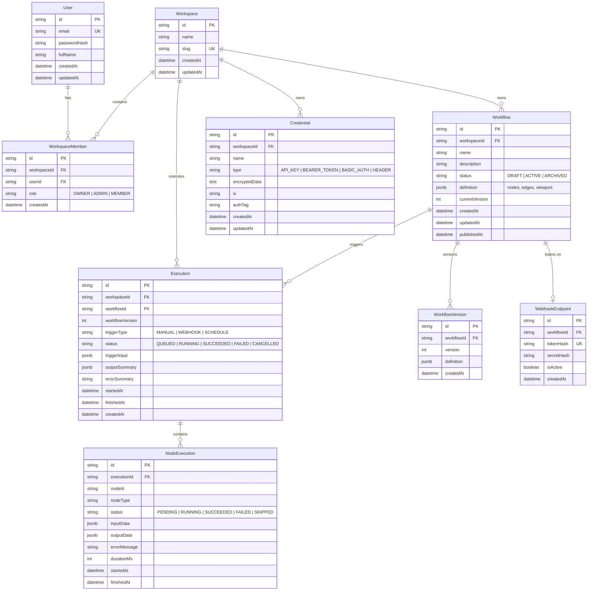
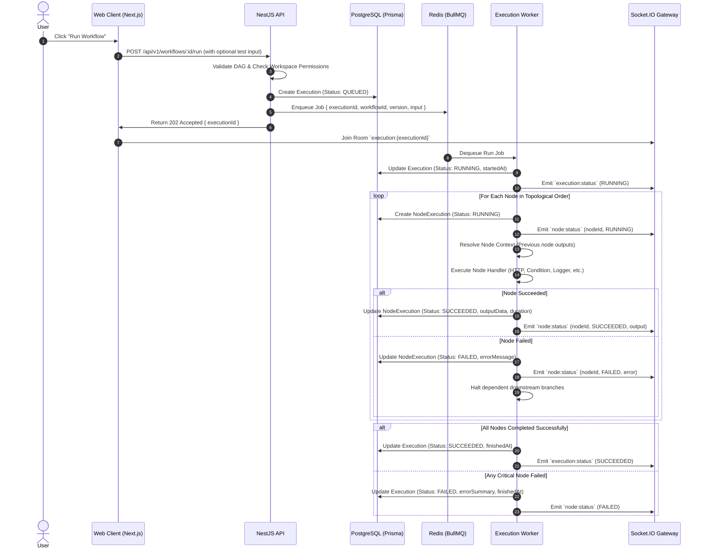

# NEXORA Architecture Specification

**Brand:** NEXORA  
**Tagline:** Automate Beyond Limits.  
**Supporting Line:** Connect. Orchestrate. Automate.  
**Version:** 1.0.0 (Phase 0 Baseline)  

---

## 1. System Overview & Core Principles

Nexora is a visual workflow automation and orchestration SaaS designed for developers and technical operators. Workflows are designed on an interactive node-based canvas, validated server-side, and executed via a distributed background queue with complete auditability, granular execution logs, and strict secret isolation.

```
                    ┌────────────────────────────────────────────────────────┐
                    │                      WEB BROWSER                       │
                    │   Next.js 15 (App Router) + React Flow (@xyflow/react) │
                    │   Zustand (Editor State) + TanStack Query + Tailwind   │
                    │   Socket.IO Client (Live Execution Logs & Statuses)    │
                    └───────────────────────────┬────────────────────────────┘
                                                │ HTTPS / WSS
                                                ▼
                    ┌────────────────────────────────────────────────────────┐
                    │                   NEXORA BACKEND API                   │
                    │             NestJS REST API (/api/v1)                  │
                    │   Auth Guards (JWT/Session) + Workspace Ownership RBAC │
                    │   Graph Validator & DAG Cycle Detector                 │
                    │   Credential Encryption Service (AES-256-GCM)          │
                    │   Webhook Token Ingestion & Rate Limiting              │
                    │   Socket.IO Gateway (Rooms per Workspace & Execution)  │
                    └───────────────┬────────────────────────┬───────────────┘
                                    │                        │
                     Prisma ORM     │                        │ Enqueue Run
                     Queries        │                        │ Jobs
                                    ▼                        ▼
                    ┌─────────────────────────┐   ┌──────────────────────────┐
                    │   PostgreSQL Database   │   │     Redis + BullMQ       │
                    │  Users, Workspaces,     │   │  Execution Queue &       │
                    │  Workflows, Executions, │   │  State Store             │
                    │  Encrypted Credentials  │   └────────────┬─────────────┘
                    └─────────────────────────┘                │
                                                               │ Worker Process
                                                               ▼
                                                  ┌──────────────────────────┐
                                                  │   NEXORA RUNTIME ENGINE  │
                                                  │   Topological DAG Runner │
                                                  │   Safe Condition Evaluator│
                                                  │   SSRF-Protected HTTP    │
                                                  │   Execution Log Emitter  │
                                                  └──────────────────────────┘
```

### Architectural Guarantees

1. **Backend as Single Source of Truth:** Workflows are never executed client-side. The UI merely edits and displays the graph. Execution is queued, verified, and orchestrated by worker processes.
2. **Deterministic DAG Execution:** Execution graphs must be directed acyclic graphs (DAGs). Cycles are detected and rejected prior to queuing. Nodes execute strictly according to topological dependency order.
3. **Strict Credential Zero-Trust:** Secrets (API keys, tokens, basic auth passwords) are stored in an encrypted vault table using AES-256-GCM with unique initialization vectors (IVs). Secrets are never returned to the frontend after creation, never stored in workflow JSON definitions, and never printed to execution logs.
4. **Multi-Tenant Workspace Isolation:** Every query, mutation, and execution job requires an explicit `workspaceId`. Cross-workspace data leakage is prevented at both the service layer and database query filter boundaries.
5. **SSRF Guarded Outbound Networking:** HTTP Request nodes cannot reach link-local addresses, RFC 1918 private IP subnets, loopback interfaces (`127.0.0.1`), or cloud instance metadata services (`169.254.169.254`). DNS resolutions are verified immediately before connection to thwart DNS-rebinding attacks.
6. **No Dynamic Code Injection (`Zero-Eval`):** Condition nodes operate using a strictly parsed abstract syntax tree (AST) with an explicit operator whitelist. No user-supplied JavaScript, `eval()`, `Function()`, or shell execution is allowed in the application.

---

## 2. Monorepo Structure

Nexora uses an `npm` workspace monorepo structure to share types, schemas, and configurations while maintaining strict module isolation between the Next.js frontend and NestJS backend.

```text
nexora/
├── apps/
│   ├── web/                         # Next.js frontend (App Router)
│   │   ├── src/
│   │   │   ├── app/                 # Route handlers & page layouts
│   │   │   │   ├── (auth)/          # /login, /register, /forgot-password
│   │   │   │   ├── (dashboard)/     # Authenticated shell layout
│   │   │   │   │   ├── dashboard/   # Summary metrics & activity overview
│   │   │   │   │   ├── workflows/   # Workflow list & /workflows/[id] canvas
│   │   │   │   │   ├── executions/  # Execution history & detail views
│   │   │   │   │   ├── integrations/# Real integration registry
│   │   │   │   │   ├── credentials/ # Secure credential vault UI
│   │   │   │   │   └── settings/    # Workspace & profile configuration
│   │   │   │   └── layout.tsx
│   │   │   ├── components/          # Reusable UI, dialogs, form elements
│   │   │   │   ├── canvas/          # React Flow custom nodes, edges, toolbar
│   │   │   │   ├── layout/          # Sidebar, header, navigation breadcrumbs
│   │   │   │   └── ui/              # shadcn/ui components (Radix primitives)
│   │   │   ├── hooks/               # Custom React hooks (sockets, canvas)
│   │   │   ├── stores/              # Zustand stores (editor state, selection)
│   │   │   ├── lib/                 # API client, token storage, formatters
│   │   │   └── styles/              # Tailwind CSS tokens & typography
│   │   ├── public/                  # Favicon, SVG logos, static assets
│   │   ├── package.json
│   │   ├── tsconfig.json
│   │   └── tailwind.config.ts
│   │
│   └── api/                         # NestJS backend application
│       ├── src/
│       │   ├── common/              # Guards, decorators, filters, interceptors
│       │   ├── config/              # Environment config & validation schemas
│       │   ├── modules/
│       │   │   ├── auth/            # Auth, JWT strategies, password hashing
│       │   │   ├── workspaces/      # Workspaces & membership RBAC
│       │   │   ├── workflows/       # CRUD, versioning, DAG validation
│       │   │   ├── engine/          # BullMQ queue, worker, DAG execution engine
│       │   │   ├── nodes/           # Node handlers (Trigger, HTTP, Condition, etc.)
│       │   │   ├── executions/      # Execution persistence & queries
│       │   │   ├── webhooks/        # Public webhook gateway & rate limiter
│       │   │   ├── credentials/     # AES-256-GCM credential vault
│       │   │   └── events/          # Socket.IO gateway for real-time telemetry
│       │   ├── prisma/              # Prisma schema & migrations
│       │   ├── app.module.ts
│       │   └── main.ts
│       ├── test/                    # Unit, integration, and E2E tests
│       ├── package.json
│       └── tsconfig.json
│
├── packages/
│   └── shared/                      # Shared types, constants & schemas
│       ├── src/
│       │   ├── nodes/               # Node types, inputs/outputs definitions
│       │   ├── workflow/            # Workflow graph schemas & validation
│       │   ├── executions/          # Execution status enums & payloads
│       │   └── index.ts
│       ├── package.json
│       └── tsconfig.json
│
├── infrastructure/
│   └── docker-compose.yml           # PostgreSQL 16 & Redis 7 configurations
│
├── docs/
│   ├── ARCHITECTURE.md              # System design & technical specification
│   ├── IMPLEMENTATION_PLAN.md       # Phase breakdown & task checklist
│   └── API.md                       # REST & WebSocket endpoint contracts
│
├── .env.example                     # Environment template with zero secrets
├── .gitignore
├── package.json                     # Monorepo root workspace config
└── README.md                        # Project documentation & setup instructions
```

---

## 3. Data Model & Database Schema

The database is managed with PostgreSQL and Prisma ORM. Strict referential integrity, foreign key constraints, cascading rules, and composite indexes ensure high query performance and data consistency.

### Entity Relationship Model



---

## 4. Workflow Engine & Execution Lifecycle

### 4.1 DAG Validation & Cycle Detection

Prior to saving or executing a workflow, the graph definition is validated:
1. **Node Integrity:** All nodes must have registered valid types (`manual-trigger`, `webhook-trigger`, `http-request`, `condition`, `delay`, `logger`).
2. **Single Trigger Rule:** A workflow graph must possess at least one trigger node, and branching cannot feed back into the trigger.
3. **Edge Consistency:** Every edge must connect a recognized source node and output handle to a recognized target node and input handle.
4. **Cycle Detection (Kahn’s Algorithm):**
   - In-degree of each node is computed based on directed edges.
   - Nodes with in-degree 0 are queued.
   - As nodes are processed, directed edges are removed, decrementing target in-degrees.
   - If the count of processed nodes equals total node count, the graph is a valid DAG.
   - If unprocessed nodes remain, a cycle exists, and the API returns a structured validation error: `422 Unprocessable Entity` with the cycle path.

### 4.2 Execution Lifecycle Flow



### 4.3 Node Execution Protocols

1. **Manual Trigger:** Ingests optional manual test payload provided by the user in the UI.
2. **Webhook Trigger:** Matches incoming HTTP request payload, headers, and query parameters, and passes them to downstream nodes.
3. **HTTP Request:**
   - Supports methods: `GET`, `POST`, `PUT`, `PATCH`, `DELETE`.
   - Replaces credential placeholders with encrypted vault values at runtime.
   - Enforces timeout (default 10s, max 30s) and payload size limit (max 1MB).
   - **SSRF Prevention:** Validates host destination. Disallows IPv4 private ranges (`10.0.0.0/8`, `172.16.0.0/12`, `192.168.0.0/16`, `127.0.0.0/8`, `169.254.0.0/16`), IPv6 loopback (`::1`), link-local (`fe80::/10`), and non-routable addresses (`0.0.0.0/8`).
4. **Condition:**
   - Evaluates left operand against right operand using strict comparison operators: `equals`, `not_equals`, `contains`, `greater_than`, `less_than`, `is_empty`, `is_not_empty`.
   - Routes execution to either the `true` output handle or `false` output handle without executing any user code.
5. **Delay:**
   - Non-blocking delay. Suspends downstream execution using BullMQ delayed jobs rather than `setTimeout` in the worker thread.
6. **Logger / Output:**
   - Captures formatted snapshot of input data for inspection in the UI console.

---

## 5. Security Architecture

1. **Authentication & Session Management:**
   - Development-safe JWT or signed HTTP-only cookies with argon2/bcrypt password hashing.
   - Expiration and refresh token rotation with workspace context embedded.
2. **Authorization & Multi-Tenancy:**
   - Every API endpoint is guarded by a `WorkspaceGuard`.
   - All Prisma queries include `{ where: { workspaceId } }`.
3. **Credential Storage at Rest:**
   - Algorithm: `AES-256-GCM`.
   - Encryption key: 32-byte key supplied via `CREDENTIAL_ENCRYPTION_KEY`.
   - Generated values per entry: Random 12-byte IV + 16-byte authentication tag (`authTag`).
   - Write-only contract: Plaintext secrets are accepted only upon creation or update; API responses return only masked metadata (e.g. `sk_live_•••••••`).
4. **Webhook Security:**
   - Public webhook URLs use high-entropy UUID tokens (`crypto.randomBytes(32).toString('hex')`).
   - Tokens are stored as SHA-256 hashes in the database.
   - IP rate limiting protects webhook endpoints from flood attacks.
5. **Data Sanitization & Redaction:**
   - Logs automatically redact values matching authorization patterns (`Bearer *`, `Basic *`, `ApiKey *`).

---

## 6. Real-Time Telemetry & WebSocket Gateway

To deliver a snappy developer experience, live execution runs stream real-time updates:
- Socket.IO server mounted on NestJS at `/socket.io`.
- Client joins a scoped room on canvas mount: `workspace:{workspaceId}` and `execution:{executionId}`.
- Events:
  - `execution:queued`: Execution placed in BullMQ.
  - `execution:started`: Worker dequeued and initiated the DAG.
  - `node:started`: A node is currently executing (canvas highlights node with electric cyan border).
  - `node:finished`: Node completed with success/failure status and duration (canvas updates status badge).
  - `execution:completed`: Overall workflow run finished with summary metrics.

---

## 7. Premium UI/UX Design System Guidelines

- **Theme Palette:**
  - Dark-first aesthetic engineered for developer workflows.
  - Background: Midnight Navy (`#101827`)
  - Elevated Cards / Modals: Deep Slate (`#172D43`)
  - Primary Accent / Active States: Electric Cyan (`#22D3EE`)
  - Secondary Accent: Neon Violet (`#8B5CF6`)
  - High Contrast Text: Soft White (`#F8FAFC`)
  - Muted Text / Inactive Borders: Slate Grey (`#64748B`)
  - Semantic Status: Success Green (`#22C55E`), Error Red (`#EF4444`), Warning Amber (`#F59E0B`)
- **Typography:**
  - Headings & Body: Geist / Inter
  - Code, Variables, JSON Payloads, and Timestamps: JetBrains Mono
- **Canvas Experience:**
  - `@xyflow/react` configured with smooth step edges, mini-map, background grid, and zoom controls.
  - Custom nodes with distinct status indicators, icons, input/output connection handles, and contextual menus.
  - Side configuration drawer for selected node properties with live validation.
